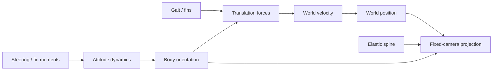

# Phase 0 · Architecture and baseline

**Status:** Engineering baseline complete and user-confirmed on 8 November 2026.  
**Scope:** Architecture definition, source audit, measurable acceptance contract and phase boundaries. No Phase 1 locomotion implementation is included.

## Phase goal

Establish a shared, testable description of the existing simulation and the architecture required for later 3D locomotion work. Phase 0 is complete when the coordinate conventions, subsystem boundaries, camera requirements, baseline evidence and approval process are documented clearly enough that Phase 1 can be implemented without ambiguity.

## Goal → subgoals → tasks

### Goal 0.1 · Establish spatial conventions

**Tasks:** P0-1

- World axes: +X is the nominal habitat-forward direction, +Y is world-up, and +Z is the lateral/depth axis.
- Body-local axes at the neutral pose: +X points from tail toward head, +Y is dorsal/up, and +Z is the fish's right/lateral direction.
- A body orientation maps local vectors into world space. The neutral orientation leaves those axes aligned.
- Quaternion storage is `{w, x, y, z}`; quaternions are normalised after composition.
- The current Euler-to-quaternion helper composes yaw about world Y, pitch about local Z in the composed frame, and roll about local X. This is the existing code convention, not yet a validated arbitrary-attitude controller.
- Positive yaw turns the forward vector toward world -Z in the current helper. Sign conventions must be covered by tests before expanding the controller.
- Position and velocity are world-space vectors. Orientation and angular rates describe attitude, not travel direction.

**Acceptance:** the convention is written down, neutral axes are explicit, and existing quaternion identity/yaw tests are identified as baseline evidence.

### Goal 0.2 · Define independent motion and attitude pathways

**Tasks:** P0-2

The runtime architecture is divided conceptually into two coupled but distinct pathways:

1. **Translation:** gait and fin response produce propulsion commands; rigid-body dynamics applies forces in body-local forward/right/up directions, integrates world-space velocity, applies drag/restoring forces, then integrates world-space position.
2. **Attitude:** steering and fin moments produce angular commands; rotational dynamics integrates angular rates and updates body orientation.

The two pathways interact through the orientation frame and hydrodynamic forces, but neither is a substitute for the other. In particular:

- Changing heading does not instantaneously rotate the velocity vector.
- A fish can point one way while drifting another way.
- Pitching downward changes the direction of body-forward thrust; it is not a direct vertical-position command.
- A later dive must therefore be an orient-then-propel sequence.

**Current implementation note:** `stepDynamics` currently contains both translation and attitude integration in one function, with separate code paths and state variables. Phase 0 documents the intended separation; extracting or redesigning those systems is Phase 1 implementation work.

**Acceptance:** the pathways, their inputs/outputs and their coupling are explicit; heading and velocity remain separately represented in the baseline state.

### Goal 0.3 · Specify fixed-camera projection and depth presentation

**Tasks:** P0-3

- The camera is fixed in the habitat. It must never follow or recenter on the fish.
- World position is transformed into camera-right, camera-up and camera-forward coordinates.
- Perspective projection uses apparent scale proportional to focal length divided by positive camera-space depth.
- Moving toward the camera increases apparent size; moving away decreases apparent size.
- The fish should begin distance softening and fading when its apparent size approaches one quarter of its reference on-screen size. This is a target threshold, not a current implemented feature.
- Off-screen/deep travel must not teleport the fish or drag the camera. Re-entry must be a later explicit movement/visibility behaviour.
- Blur and fade must be smooth functions of distance/apparent scale, not abrupt visibility toggles.

**Acceptance:** the camera invariant, projection relationship and target fade threshold are documented and distinguished from current implementation.

### Goal 0.4 · Establish baseline evidence and acceptance contract

**Tasks:** P0-4

**Baseline source audit (8 November 2026):**

| Area | Existing baseline |
|---|---|
| Maths | Vector operations, angle wrapping, quaternion construction/normalisation/rotation |
| Dynamics | Body-local thrust/side/lift force, speed-dependent drag, vertical restoring term, soft bounds, yaw/pitch/roll angular response |
| Body | 19-node damped elastic spine, travelling muscle wave, tail-motion-derived thrust, pectoral-fin response |
| Rendering | Fixed camera basis, perspective projection, procedural mesh and depth-sorted faces |
| Behaviour | Autonomous CRUISE, EXPLORE, TURN, DART, GLIDE and RECOVER switching |
| Tests | 17 existing Node test cases in `tests/core.test.js` |

**Existing test coverage:** quaternion identity and yaw direction; angle wrapping; forward acceleration; drag; body-wave distribution; tail propulsion; energy recovery; body cross-section deformation; fin steering and drag; sustained yaw; spine stability; tail-root continuity.

**Known baseline limitations:**

- Spine deformation is primarily lateral, not a full two-axis 3D centreline.
- The current dynamics implementation has a narrow attitude range and does not yet support unrestricted 3D attitude.
- Translational forces are expressed along body axes; the complete requested 3D movement capability is not yet implemented.
- Caudal-fin rendering is not fully reconstructed from a deforming attachment frame.
- Depth projection exists, but robust depth travel, distance blur/fade and natural re-entry are not implemented.
- The model is phenomenological. It is not a validated animal model or CFD solver.

**Phase 1 acceptance contract:**

- All simulation state remains finite under sustained and compound manoeuvres.
- Translation is measured independently from heading and angular attitude.
- Forward, reverse, lateral, vertical and diagonal motion are possible without camera movement.
- Depth changes apparent scale monotonically under the fixed perspective camera.
- Distance blur/fade begins near the agreed quarter-scale threshold and changes continuously.
- The fish can leave and re-enter the visible habitat without a camera chase or position teleport.
- Existing body/gait tests remain green while new tests cover each added degree of freedom.
- Each criterion has a reproducible test or visual review procedure; numerical thresholds are recorded with the implementing phase rather than invented before its model exists.

**Test execution note:** this baseline records the 17 test cases present in source. It does not claim a fresh local test execution. The repository's GitHub Actions `Core tests` workflow is the executable regression check.

**Acceptance:** baseline inventory, known limitations and measurable Phase 1 criteria are recorded.

### Goal 0.5 · Lock the phase sequence and approval protocol

**Tasks:** P0-5

| Phase | Goal | Dependency / gate |
|---|---|---|
| 0 | Architecture and baseline | Initial review and explicit user confirmation |
| 1 | True 3D locomotion foundation | Phase 0 explicitly approved by the user on 8 November 2026; Phase 1 is authorised and underway |
| 2 | Elementary movement primitives | Phase 1 approval |
| 3 | Basic composite motions | Phase 2 approval |
| 4 | Complex manoeuvre arrangements | Phase 3 approval |
| 5 | Autonomous natural behaviour | Phase 4 approval |
| 6 | Environment and water surface | Deferred until locomotion and behaviour are accepted |
| 7 | Integration and polish | Prior phases accepted |

Each task has two independent marks: assistant completion with evidence, then user confirmation after review. The user confirmed all five Phase 0 tasks on 8 November 2026. The explicit Phase 0 phase gate was also approved, authorising Phase 1.

**Acceptance:** phase order, dependencies, two-key task completion and explicit phase approval are recorded.

## Architecture overview

Translation and attitude are separate state pathways coupled by body orientation. The fixed camera is an observer, not a controller.

## Phase 0 completion evidence

- Coordinate and quaternion convention: this document, Goal 0.1.
- Translation/attitude architecture: this document, Goal 0.2, checked against `src/core/dynamics.js` and `src/main.js`.
- Fixed-camera projection contract: this document, Goal 0.3, checked against `src/main.js`.
- Baseline and acceptance contract: this document, Goal 0.4, checked against `tests/core.test.js` and the source audit.
- Phase boundaries and review gate: this document, Goal 0.5, cross-checked against `ROADMAP.md` and the Plan presentation.

## Explicit exclusions

Phase 0 does not implement unrestricted 3D attitude, independent six-axis locomotion, 3D spine curvature, full axial roll, compound manoeuvres, autonomous planning changes, or environment work. Those belong to later phases. No Phase 1 simulation code is included in this milestone.
